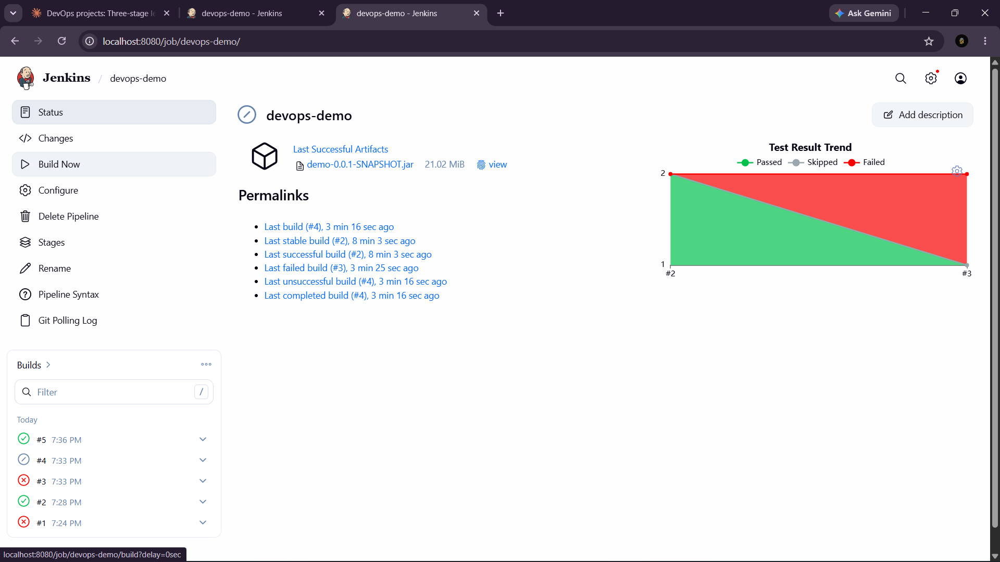
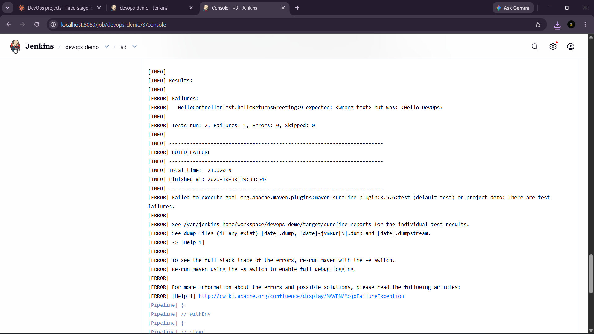
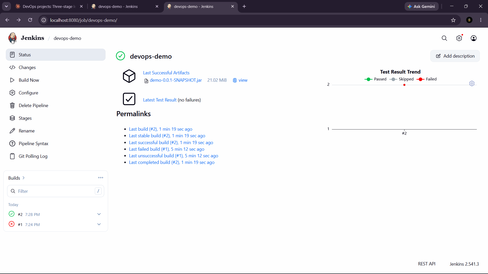
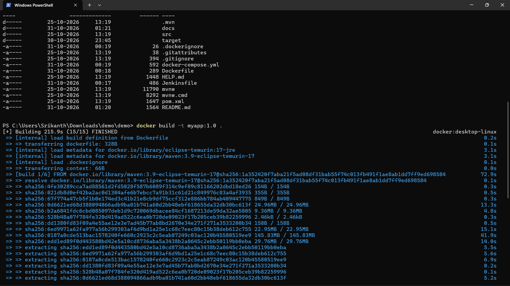
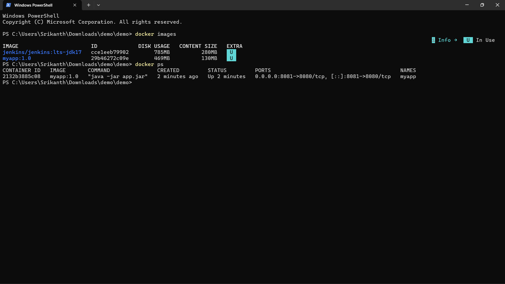
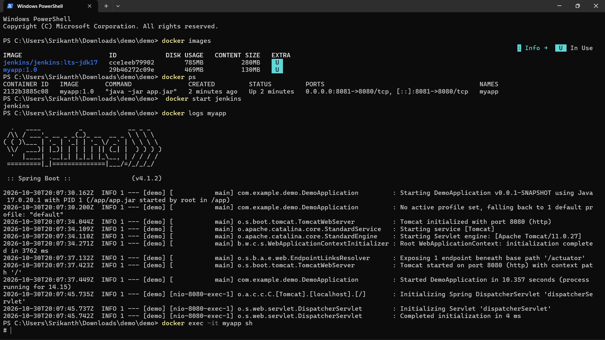
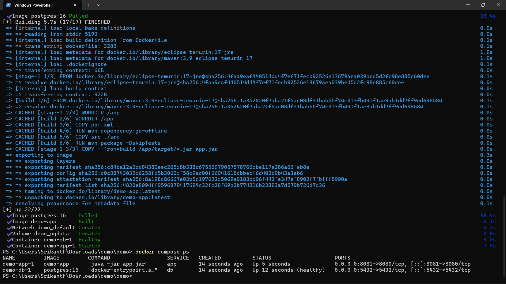

# DevOps Demo: Jenkins CI Pipeline and Docker

A Spring Boot app with a Jenkins pipeline that builds, tests and packages the code on every push to GitHub.

## What it does
Checkout -> Build -> Test -> Package. JUnit results are published and the JAR is archived.

## Tech
Java 17, Spring Boot, Maven, Git/GitHub, Jenkins, Docker, Docker Compose, PostgreSQL

## Pipeline (see `Jenkinsfile`)
1. Checkout code from GitHub
2. `mvn clean compile`
3. `mvn test` (JUnit results published in Jenkins)
4. `mvn package` (JAR archived as a build artifact)

Jenkins polls GitHub every 2 minutes and starts a build automatically.

## Proof it works

**Build history and test trend: green, red (failing test), green again**



- #1 failed: wrong branch configured (`*/master` instead of `*/main`)
- #2 passed: first successful build
- #3 failed: I broke a test on purpose, and the pipeline stopped before packaging
- #5 passed: test fixed, pipeline green again

**A failing test stops the pipeline (build #3 console)**



**Archived JAR and test results (no failures)**



## Project 2: Dockerized app

A multi-stage `Dockerfile` builds the JAR with Maven, then copies it into a small Java 17 runtime image. `docker-compose.yml` starts the app and a PostgreSQL database, and the app waits until the database is healthy.

**Build the image**
```
docker build -t myapp:1.0 .
docker run -d -p 8081:8080 --name myapp myapp:1.0
```


**Container running (port 8081 mapped to 8080 inside)**



**Logs and shell inside the container**



**Docker Compose: app and database (healthy)**
```
docker compose up -d --build
docker compose ps
docker compose down
```


## What I learned
- Writing a declarative `Jenkinsfile`
- Configuring Maven as a Jenkins tool
- Using a failing test to verify the pipeline blocks bad code
- Debugging a Git branch configuration error from the console log
- Writing a multi-stage Dockerfile and a Compose file with a database health check
- Running, inspecting and stopping containers with `docker ps`, `logs` and `exec`

## Run locally
```
.\mvnw clean package
java -jar target\demo-0.0.1-SNAPSHOT.jar --server.port=8082
```
Then open http://localhost:8082/hello (port 8080 is used by Jenkins)
